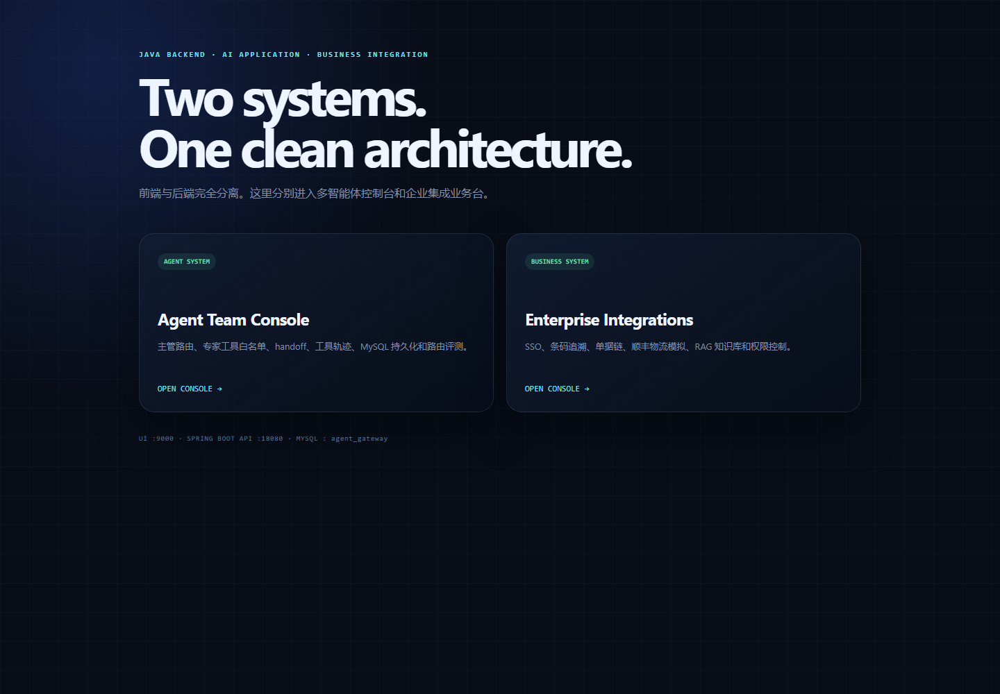
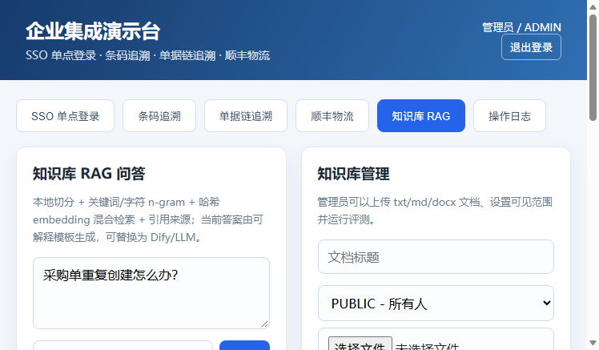
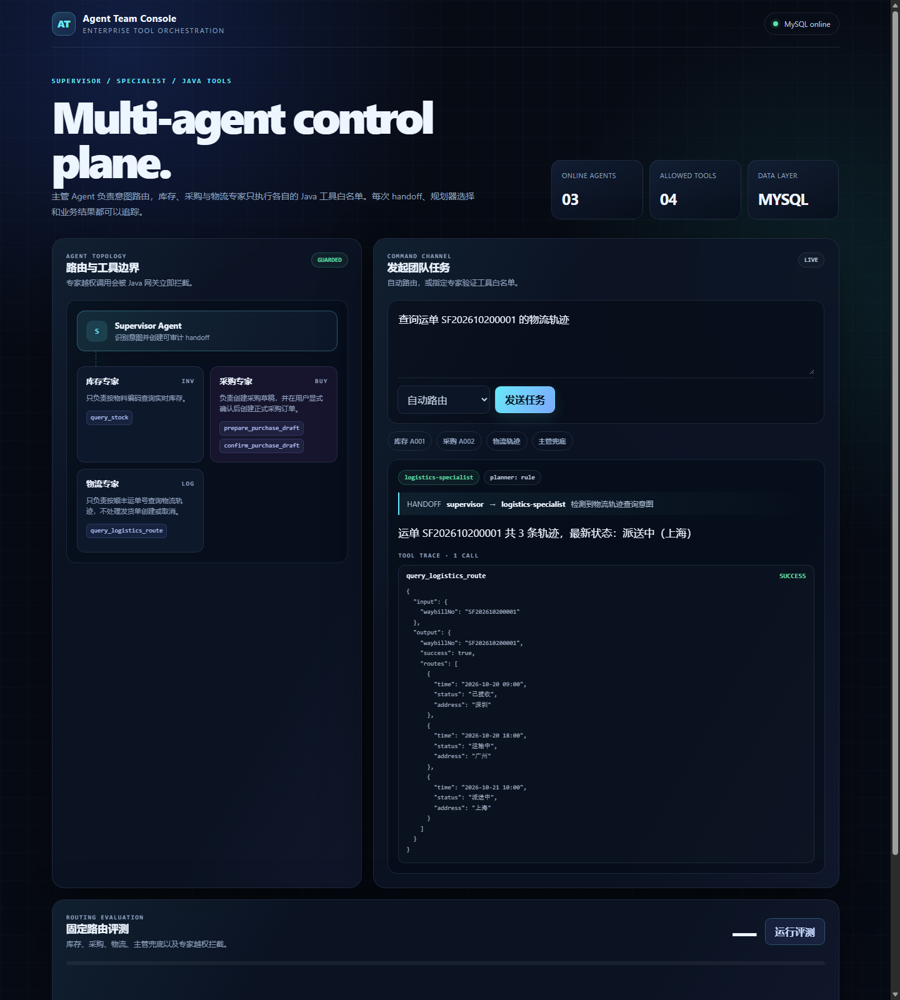
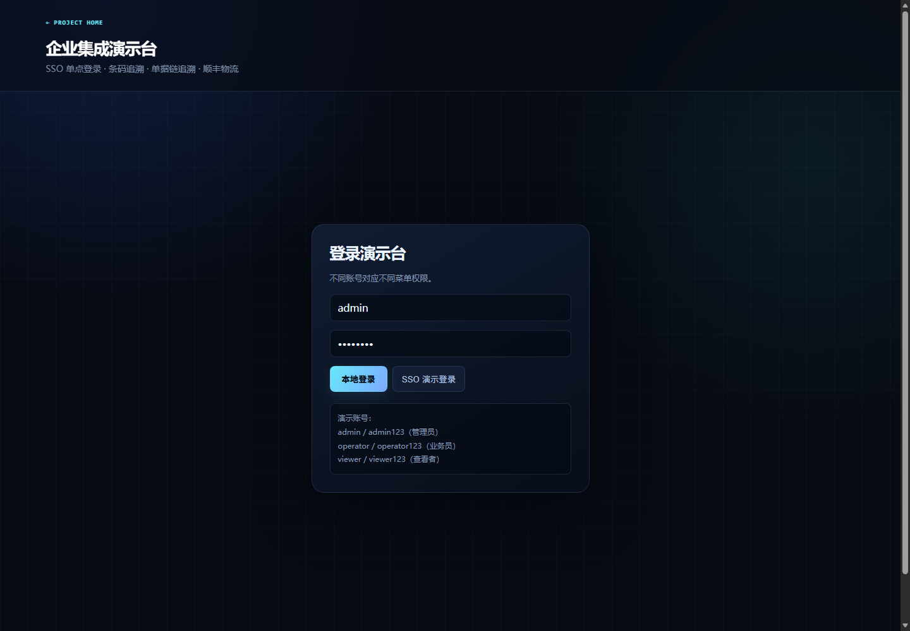

# Enterprise Agent & Integration Demo


一个面向企业业务场景的 Java 全栈演示项目，包含：

- **Agent Gateway Demo**：短期用户上下文、工具注册、规则/LLM Tool Calling、主管 Agent 路由、专家工具白名单、库存查询、采购草稿、确认执行、幂等和 SSE
- **Business Integrations Demo**：SSO 单点登录、条码追溯、单据链追溯、顺丰物流模拟
- **RAG Knowledge Base**：文档切分、关键词 + 哈希 embedding 混合检索、引用来源、权限过滤和评测
- **Vue 2 控制台**：在一个页面演示 SSO、条码、单据链和顺丰流程

项目使用 Java 8、Spring Boot 2.7、Vue 2，MySQL 为默认持久化方案，Redis 按需启用。









## 目录

```text
api/
  src/main/java/
    com/example/agentdemo/    Agent 业务包
    com/example/integrations/SSO、追溯、顺丰和 RAG 业务包
  src/main/resources/         配置与 MySQL 初始化脚本
  scripts/run-mysql.ps1       单一 API 启动脚本
  pom.xml                     一个 Spring Boot API
ui/
  server.mjs                 静态页面服务与 API 代理（9000）
  agent-console/             多智能体控制台
  business-console/          企业集成控制台
docs/                        架构、验证记录、面试说明
```

## 快速开始

一键启动 UI 和单一 Spring Boot API：

```powershell
powershell -ExecutionPolicy Bypass -File .\scripts\start-dev.ps1
```

查看状态和停止：

```powershell
powershell -ExecutionPolicy Bypass -File .\scripts\status-dev.ps1
powershell -ExecutionPolicy Bypass -File .\scripts\stop-dev.ps1
```

打开统一入口：

```text
http://localhost:9000/
```

访问：

```text
http://localhost:9000/agent/
http://localhost:9000/business/
```

健康检查：

- UI：`http://localhost:9000/health`
- API：`http://localhost:18080/api/health`

也可以手动启动两个进程：

```powershell
powershell -ExecutionPolicy Bypass -File .\api\scripts\run-mysql.ps1
npm run dev --prefix ui
```

### MySQL 数据

单一 API 默认连接 `agent_gateway` MySQL 数据库。库存、Agent 上下文、采购草稿和订单，
以及 SSO 映射、条码、单据链、顺丰日志和操作日志都使用同一个数据源。

```powershell
powershell -ExecutionPolicy Bypass -File .\api\scripts\run-mysql.ps1
```

本机凭据保存在 Git 忽略的 `api/.local/mysql.password`。其他环境可通过
`AGENT_DB_USERNAME`、`AGENT_DB_PASSWORD` 提供凭据，表结构会自动初始化。

## 设计重点

### 1. 模型不直接写业务库

Agent 只负责意图理解和参数准备。Java 负责权限、校验、草稿、确认、幂等和审计。

### 2. 可信用户上下文

模型工具调用不直接接触登录 Token。后端签发短期 `contextId`，工具调用时恢复最小用户上下文。

### 3. 写操作闭环

```text
validate
  -> draft
  -> user confirmation
  -> idempotent create
  -> result query
```

### 4. 企业集成可靠性

- SSO：一次性 code、nonce、timestamp、防重放
- 条码：事件流 + 单据链递归 + visited 防循环
- 顺丰：嵌套报文、签名、双层成功判断、运单号回写

### 5. RAG

- 文档按固定窗口切分，带重叠
- 关键词、中文双字 n-gram 和哈希 embedding 混合检索
- 支持 txt / md / docx / pdf 文档
- 可见范围：PUBLIC / OPERATOR / ADMIN
- 返回引用片段和分数
- 内置 10 条评测问题
- 当前答案由可解释模板生成，可替换为 Dify 或任意 LLM

可选 OpenAI-Compatible LLM：

```yaml
rag:
  llm:
    enabled: true
    base-url: https://api.openai.com/v1
    api-key: ${RAG_LLM_API_KEY}
    model: gpt-4o-mini
```

未配置 Key 或 LLM 调用失败时自动降级到模板回答。

可选真实 Embedding：

```yaml
rag:
  embedding:
    provider: openai
    base-url: https://api.openai.com/v1
    api-key: ${RAG_EMBEDDING_API_KEY}
    model: text-embedding-3-small
```

默认 `provider: hash`，没有外部 Key 也能运行。

Agent Gateway 支持可选 OpenAI-Compatible Tool Calling。未配置模型时使用确定性的规则规划器；
模型调用失败会自动降级。模型只负责选择工具和参数，Java 仍负责上下文、权限、校验、草稿、
人工确认和幂等。

多 Agent 模式采用可审计的 `supervisor -> specialist` 路由。主管将库存和采购任务交给不同专家，
每个专家只有自己的工具白名单；这不是不受控的 Agent 群聊，也不能绕过人工确认。

前端启动后打开 `http://localhost:9000/agent/` 可以使用多智能体控制台，
查看 handoff、工具调用，并运行固定的 8 条路由评测。

可选 pgvector：

```powershell
cd api
docker compose up -d postgres
mvn spring-boot:run "-Dspring-boot.run.profiles=pgvector"
```

pgvector 模式使用 PostgreSQL + `vector(1536)` 存储 chunk；默认 memory 模式不受影响。

## 演示登录

| 账号 | 密码 | 角色 |
|---|---|---|
| `admin` | `admin123` | 管理员 |
| `operator` | `operator123` | 业务员 |
| `viewer` | `viewer123` | 查看者 |

不同角色会看到不同菜单；管理员可以查看操作日志。

- 管理员：SSO、条码、单据链、顺丰、操作日志
- 业务员：SSO、条码、单据链、顺丰
- 查看者：SSO、条码、单据链

所有角色还可以使用“知识库 RAG”页签；管理员可以上传文档、删除文档和运行评测。

## 验证

- 单一 API：38 个自动化测试通过
- Agent：工具调用、降级、权限边界、确认幂等
- Business：登录权限、SSO 防重放、条码、单据链、顺丰和 RAG
- Vue 页面：真实浏览器交互验证通过
- GitHub Actions：每次推送自动编译、测试和打包

详见 [docs/verification.md](docs/verification.md)。

## 边界

这是一个干净室学习与作品集项目：

- 不包含任何公司完整源码
- 不包含客户数据或生产密钥
- 不调用真实顺丰接口
- SSO token 和业务数据均为演示数据
- 生产使用前需要接入真实认证、数据库、审计和限流
